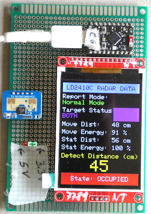

# ESP32 LD2410C Human Presence Sensor

This repository accompanies the article "**How to Use an HLK LD2410C Human Presence Sensor with an ESP32 (Beginner Tutorial)**" published here: https://medium.com/@androidcrypto/how-to-use-an-hlk-ld2410c-human-presence-sensor-with-an-esp32-beginner-tutorial-17c9adde8e5a?sharedUserId=androidcrypto

In the **[Documentation](./Documentation)** folder, you will find the **HLK LD2410C Life Presence Sensor Module Data Sheet V1.00** and the **HLK-LD2410C Serial communication protocol V1.07** and provided here as copies. **Naturally, all rights remain with the manufacturer.**



## Sketches

The following sketches does not require an additional library to drive the LD2410C sensor:

### The first sketch with a Serial Monitor output
**[Esp32_C6_LD2410C_Raw_v01](./Esp32_C6_LD2410C_Raw_v01)**

### The second sketch with a Serial Monitor output that cuts the data stream into pieces
**[Esp32_C6_LD2410C_Raw_Record_Limiter_v01](./Esp32_C6_LD2410C_Raw_Record_Limiter_v01)**

### The third sketch with a Serial Monitor output that parses the data
**[Esp32_C6_LD2410C_Raw_Parser_v02](./Esp32_C6_LD2410C_Raw_Parser_v02)**

### The fourth sketch with a Serial Monitor output that parses the data and additionally uses a TFT display
**[Esp32_C6_Lov_ST7789_LD2410C_Raw_Parser_v04](./Esp32_C6_Lov_ST7789_LD2410C_Raw_Parser_v04)**


## Development Environment (Arduino)
````plaintext
Arduino IDE Version 2.3.10 (Windows)
arduino-esp32 boards Version 3.3.11 (https://github.com/espressif/arduino-esp32) that is based on Espressif ESP32 Version 5.5.5
````
